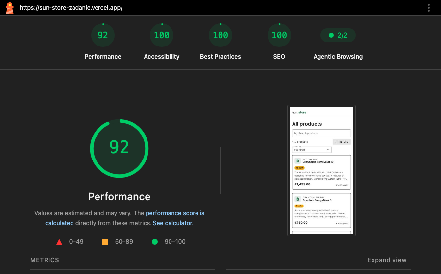
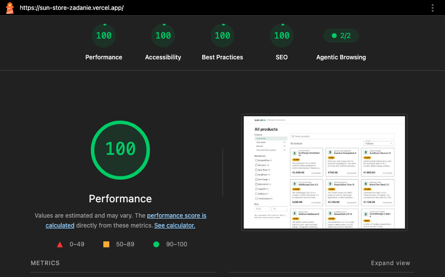

# sun.store: listing produktów (zadanie rekrutacyjne)

- **Aplikacja:** https://sun-store-zadanie.vercel.app
- **Repozytorium:** https://github.com/michalduszadev/sun-store-zadanie

Nuxt 4 · Vue 3 (Composition API) · TypeScript strict · Vuetify 3 · Nitro · Zod · Vitest · Playwright · Vercel

## Uruchomienie

Wymagania: Node 24, pnpm 12 (wersja przypięta w `packageManager`, działa przez Corepack).

```bash
pnpm install
pnpm dev          # http://localhost:3000
pnpm test         # Vitest: 73 testy jednostkowe
pnpm test:e2e     # Playwright: build produkcyjny + 2 scenariusze (lokalny Chrome)
pnpm typecheck    # vue-tsc, strict
pnpm lint
```

Te same testy E2E na wdrożeniu: `E2E_BASE_URL=https://sun-store-zadanie.vercel.app pnpm test:e2e`.

## Co jest zrobione

- Filtrowanie po **kategorii**, **producencie** (wielokrotny wybór, z licznikami wyników), **zakresie cen** i **pojemności lub mocy** (kWh/W).
- **Wyszukiwanie** po nazwie, producencie i opisie.
- **Sortowanie** po cenie, nazwie, kWh/W oraz **cenie za kWh lub W** (dla instalatora B2B to realna metryka).
- Filtrowanie, wyszukiwanie, sortowanie, paginacja i liczniki odbywają się na **serwerze** (`GET /api/products`, Nitro). Dane są czytane z CSV, bez bazy.
- **Stan filtrów w URL.** Link z filtrami renderuje się w SSR z właściwymi wynikami, a przyciski wstecz i dalej działają.
- **SEO zależne od filtrów:** tytuł i H1 odzwierciedlają każdy aktywny filtr (kategoria, producenci, zakres kWh/W, cena, wyszukiwanie, strona); do tego opis, `robots`, canonical, Open Graph i JSON-LD `ItemList`.
- **Responsywność:** na telefonie filtry są w pełnoekranowym dialogu.
- Wdrożenie na Vercel. Lighthouse: mobile 92, desktop 100, Accessibility, Best Practices i SEO po 100.
- Testy: Vitest, 73 testy (wyciąganie kWh/W, CSV, kontrakt zapytania, filtrowanie, fasety, SEO, paginacja, pola powiązane z URL) i Playwright (scenariusz z zadania oraz SSR bez JavaScriptu).

## Struktura

```
shared/                          # kod wspólny dla serwera i przeglądarki (Nuxt 4 shared/)
  utils/productQuery.ts          # kontrakt URL ↔ filtry: schemat zod, normalizacja, serializacja
  utils/categories.ts            # kategorie i ich jednostki (jedno źródło prawdy)
  utils/listingSeo.ts            # tytuł/opis/robots/canonical + JSON-LD (czyste funkcje)
  utils/format.ts                # ceny (EUR), kWh/W, zakresy: wspólne dla UI i SEO
  utils/slugify.ts               # slugi w URL ("Quantum Energy" → quantum-energy)
  types/                         # Product, ProductsResponse
server/
  assets/products.csv            # dane (pakowane do builda serwera)
  utils/specs.ts                 # wyciąganie kWh/W z tekstu
  utils/parseProducts.ts         # CSV → produkty (walidacja wierszy)
  utils/catalog.ts               # jednorazowe wczytanie katalogu
  utils/queryProducts.ts         # filtrowanie, wyszukiwanie, sortowanie, paginacja, fasety
  api/products.get.ts            # GET /api/products
app/
  composables/useProductQuery.ts # jedyne miejsce, które czyta i zapisuje URL
  composables/useDraftField.ts   # pole tekstowe powiązane z URL, odporne na wyścig z nawigacją
  pages/index.vue                # useFetch + SEO
  components/                    # filtry, wyszukiwarka, karta, paginacja, chipy
  utils/pagination.ts            # numery stron z przerwami (1 … 4 5 6 … 12)
tests/unit/, tests/e2e/, playwright.config.ts
```

Szczegółowy dziennik decyzji i poprawek w trakcie pracy: [NOTES.md](NOTES.md). Słownik pojęć: [GLOSSARY.md](GLOSSARY.md).

---

## 1. Kluczowe decyzje i dlaczego

**URL jako jedyne źródło stanu, bez Pinii.** Filtry istnieją tylko w query stringu. Composable `useProductQuery` wylicza z niego typowany stan i zapisuje zmiany przez `router.push`. SSR, linki do udostępnienia i przycisk wstecz działają więc z definicji, a nie dzięki synchronizacji dwóch stanów, co jest typowym źródłem błędów. `useFetch` obserwuje znormalizowane query i pobiera dane ponownie przy każdej zmianie. Podczas SSR wynik trafia do payloadu, więc przeglądarka nie pobiera go drugi raz.

**Jeden kontrakt zapytania w `shared/`.** Ten sam schemat zod parsuje `getQuery()` na serwerze i `route.query` w przeglądarce. Każde pole ma `.catch()`: niepoprawna wartość jest pomijana, więc `?page=abc` daje stronę 1, a nie błąd 400 czy 500. Link z literówką i tak pokazuje listę. Normalizacja:
- zamienia min z max, jeśli podano je odwrotnie;
- sortuje slugi producentów;
- usuwa wartości domyślne z URL.

Dzięki temu jeden zestaw filtrów ma jeden URL, co ma znaczenie dla cache CDN i canonical. Link ze śmieciowymi parametrami (`?category=xx&utm_source=…`) pokazuje to samo co bez nich, a jego canonical wskazuje czysty adres. Reguły zmian z UI też są w tym pliku: każda zmiana wraca na stronę 1, a zmiana kategorii czyści zakres kWh/W.

**Logika jako czyste funkcje, I/O osobno.** `parseProductsCsv`, `extractSpec`, `queryProducts` i `buildListingSeo` nie znają Nuxta, więc testuje je Vitest bez uruchamiania aplikacji. Endpoint i strona tylko je łączą.

**CSV jako server asset.** Plik leży w `server/assets`, a czyta go `useStorage('assets:server')`, nie `fs`. Nitro pakuje go do funkcji serverless, a na Vercel względne ścieżki do plików nie istnieją. Katalog jest parsowany raz na instancję (zapamiętany promise) i zwracany jako `readonly`, bo współdzielą go wszystkie żądania. Wiersze waliduje zod: zły wiersz jest pomijany z ostrzeżeniem i numerem linii, a reszta katalogu działa.

**Fasety jak w Algolii.** Licznik przy producencie liczy wyniki z pominięciem *własnego* filtra („ile byłoby wyników dla EcoCharge przy pozostałych filtrach”). Zaznaczony producent z wynikiem 0 zostaje na liście, żeby dało się go odznaczyć. Zakresy cen i kWh/W są liczone z całej kategorii, żeby pola nie zmieniały granic przy każdym kliknięciu.

**Filtr i sortowanie po kWh/W tylko po wybraniu kategorii.** kWh (baterie) i W (panele) są nieporównywalne. Bez kategorii serwer ignoruje te parametry, a UI podpowiada, że trzeba wybrać baterie albo panele.

**Pola tekstowe powiązane z URL** (wyszukiwarka, zakresy cen i kWh/W) korzystają z jednego modułu `useDraftField`. Nawigacja kończy się asynchronicznie, więc zmiana URL wywołana własnym zatwierdzeniem przychodzi z opóźnieniem i nie może nadpisać tego, co użytkownik w tym czasie dopisał. Ten wyścig wyszedł najpierw w wyszukiwarce, a przegląd architektury znalazł go ponownie w polach ceny (wpisanie minimum, Tab, pisanie maksimum czyściło pole). Poprawka jest teraz w jednym miejscu, z testem jednostkowym odtwarzającym kolejność zdarzeń.

**Wyszukiwanie.** Każde słowo musi wystąpić w nazwie, producencie lub opisie, bez rozróżniania wielkości liter. Liczby pasują tylko jako całe liczby: „10” znajdzie „10kWh”, ale nie „100” ani „10.5”. Pole ma debounce 350 ms, a jedna sesja pisania, trwająca do Entera albo wyjścia z pola, tworzy jeden wpis w historii (pierwsze zatwierdzenie `push`, kolejne `replace`). Wstecz nie przechodzi więc przez niedopisane frazy, a każde osobne wyszukiwanie da się cofnąć.

**Paginacja na serwerze (24 na stronę) jako zwykłe linki.** HTML jest mniejszy, a robot może przejść po `<a href="?page=2">`. `v-pagination` renderuje przyciski, więc paginacja jest napisana od nowa. Kategorie też są linkami.

**Vuetify 3, bo to stack sun.store, ale z myślą o wydajności:**
- ikony SVG z `@mdi/js` zamiast fontu ikon;
- systemowy font zamiast Roboto;
- zwykły `<header>` zamiast `v-app-bar`, który mierzy się dopiero po hydracji i powodował przesunięcie układu (CLS);
- **opóźniona hydracja** sidebaru (`hydrate-on-visible`): na telefonie jest ukryty, więc nie hydratuje się wcale;
- lżejsza karta produktu;
- natywny `<select>` zamiast `v-select`.

**Założenia przy niejasnościach.** W CSV nie ma waluty, więc przyjąłem **EUR** (europejski marketplace). Przyjąłem też, że ceny są **netto**, bo w B2B zwykle podaje się je bez VAT. UI jest po angielsku, bo dane są po angielsku, a rynek europejski. README jest po polsku.

## 2. Jak pozyskałem kWh/W i jakie przypadki brzegowe obsłużyłem

Każda kategoria ma w `categories.ts` przypisaną jednostkę: baterie `kWh`, panele `W`, złączki brak. `specs.ts` dla każdej jednostki ma regułę: wzorzec i zakres wiarygodnych wartości.

1. **Najpierw opis**, bo podaje jednostkę wprost („10kWh”, „450W”). Wygrywa **pierwsze** dopasowanie.
2. **Liczba na końcu nazwy** („EcoCharge HomeVault 13.5”) służy jako zapas i do sprawdzenia: przy niezgodności z opisem logowane jest ostrzeżenie, a wygrywa opis.
3. **Zakres wiarygodności** (bateria 0,5–200 kWh, panel 10–1000 W): wartość spoza zakresu jest odrzucana i bierzemy liczbę z nazwy.

| Przypadek | Przykład z danych | Obsługa |
|---|---|---|
| Opis wspomina też pojemność całego zestawu | PowerFlow Stack 7.5: „…for a total of **30kWh**” | pierwsze dopasowanie (7.5) |
| Opis wspomina rozmiar modułu | AuraPower Reserve 12.5: „(five **2.5kWh** modules)”; PowerFlow Stack 7 / 10.5 / 14 | pierwsze dopasowanie |
| Inne jednostki obok W | złączki: „1500V”, „15A”; teksty z „5kW”, „10kWh” | `W` rozróżnia wielkość liter i ma granice słowa, więc kW, kWh, V i A się nie łapią |
| Zapis | „7,5 kWh”, „400 W”, „410Wp” | przecinek dziesiętny, spacja przed jednostką, Wp |
| Brak jednostki w opisie | – | liczba z nazwy |
| Nieprawdopodobna wartość | „0.45W per cell” | odrzucona, bierzemy liczbę z nazwy |
| Kategoria bez spec | złączki | `null`, a z nią brak ceny za jednostkę |

Wynik: wszystkie 50 baterii i 50 paneli ma kWh/W, a wartość z opisu zawsze zgadza się z nazwą. Test na prawdziwym CSV pilnuje tego dla całego pliku. **Świadomie nieobsłużone**, bo w danych nie występują: separator tysięcy („1,500 W” → 1,5 → poza zakresem → liczba z nazwy), zakresy („400–450 W”), jednostki Wh i MWh oraz zapis „450 watts”.

## 3. Indeksowanie kombinacji filtrów w wyszukiwarkach

Indeksowałbym tylko kombinacje z realnym popytem w wyszukiwarce i wystarczającą liczbą wyników: kategorię, producenta, kategorię z producentem, ewentualnie progi pojemności lub mocy („baterie 10 kWh”). Dostałyby czyste, stabilne URL-e (np. `/baterie/ecocharge`), własny tytuł i opis oraz wpis w `sitemap.xml`. Wszystkie pozostałe kombinacje (wyszukiwanie, sortowanie, zakresy, kilku producentów, puste wyniki) dostają `noindex, follow` z canonical na samą siebie, a listę indeksowanych faset weryfikowałbym danymi z Search Console i analizą słów kluczowych.

Obecna implementacja realizuje już tę regułę na parametrach query (`buildListingSeo`). Brakuje czystych ścieżek i sitemapy.

## 4. Czego celowo nie zrobiłem i co zrobiłbym dalej

### Celowo pominięte

**Zapisywanie gotowych stron na serwerach Vercela (cache HTML na CDN, tzw. ISR)**
- *Co to jest:* Vercel może zapamiętać wygenerowaną stronę i podawać ją kolejnym osobom bez ponownego renderowania. Szybciej i taniej.
- *Dlaczego nie teraz:* w domyślnej konfiguracji Vercel rozpoznaje stronę tylko po ścieżce (`/`) i ignoruje parametry po `?`. Wtedy `/?category=battery` i `/?category=solar-panel` dostałyby ten sam zapamiętany HTML, czyli link z filtrami pokazałby złe wyniki. Zepsułoby to wymaganie „link z filtrami renderuje się po stronie serwera z właściwymi wynikami”.
- *Co bym zrobił:* włączył cache z jawną listą parametrów, które odróżniają strony (`allowQuery`), i sprawdził to testem E2E. Odpowiedzi API są już zapamiętywane na CDN (nagłówki `s-maxage` i `stale-while-revalidate`).

**Mniejszy plik CSS Vuetify**
- *Co to jest:* Vuetify dołącza tysiące gotowych klas pomocniczych (np. `mb-4`, `d-flex`). Przeglądarka musi pobrać cały plik CSS, zanim pokaże stronę; na telefonie w Lighthouse to ok. 150–300 ms.
- *Dlaczego nie teraz:* usunięcie nieużywanych klas wymaga konfiguracji Sass i przejrzenia wszystkich komponentów, a wynik mobile i tak wynosi 92/100.
- *Co bym zrobił:* wyłączył nieużywane grupy klas w konfiguracji Sass Vuetify (`$utilities`).

**Wyszukiwanie odporne na literówki i odmiany słów**
- *Co to jest:* dziś „baterry” nie znajdzie „battery”, a „panels” nie znajdzie „panel”.
- *Dlaczego nie teraz:* napisanie tego samemu to osobny duży temat, a sun.store ma do tego Algolię.
- *Co bym zrobił:* przeniósł wyszukiwanie i filtry do Algolii (InstantSearch).

**Strony pojedynczych produktów**
- Zadanie ich nie wymaga. Skutek uboczny: dane dla wyszukiwarek (JSON-LD) nie mają linków do produktów, więc Google nie pokaże przy nich np. ceny w wynikach wyszukiwania (tzw. rich results).

### Co zrobiłbym dalej

1. **Ładne adresy stron, które mają być w Google.** Na przykład `/baterie/ecocharge` zamiast `/?category=battery&manufacturer=ecocharge`, plus plik `sitemap.xml` z ich listą. Adres domeny do canonical ustawiłbym w konfiguracji (`runtimeConfig.public.siteUrl`). Dziś jest brany z adresu żądania, więc kopia strony na `*.vercel.app` i docelowa domena mogłyby ze sobą konkurować w Google.
2. **Wiele języków i walut.** sun.store działa w 7 językach: tłumaczenia (`@nuxtjs/i18n`), ceny netto lub brutto zależnie od kraju. Kwoty trzymałbym w groszach (liczby całkowite), bo ułamki w JavaScripcie dają błędy zaokrągleń (`0.1 + 0.2` to nie dokładnie `0.3`).
3. **Automatyczne sprawdzanie każdej zmiany (CI).** GitHub Actions uruchamia lint, typecheck, Vitest i Playwright przy każdym pull requeście; Playwright także na wersji podglądowej z Vercela.
4. **Pomiar u prawdziwych użytkowników i zbieranie błędów.** Lighthouse to symulacja w laboratorium. Vercel Speed Insights mierzy szybkość u realnych osób, a Sentry zbiera błędy z produkcji.
5. **Algolia przy dużym katalogu.** Przy tysiącach produktów filtrowanie w pamięci serwera przestaje wystarczać.
6. **Porządki w kodzie z przeglądu architektury.** Dziś wszystko działa poprawnie, więc nie ryzykowałem zmian tuż przed wysłaniem:
   - liczniki przy filtrach liczone tą samą funkcją co wyniki po kliknięciu (dziś dwa miejsca w kodzie muszą się ze sobą zgadzać; sprawdziłem 43 przypadki, zgadzają się);
   - jedna lista sortowań zamiast trzech miejsc w kodzie (dziś nowe sortowanie to zmiany w 3 plikach);
   - jedna funkcja opisująca aktywne filtry dla chipów i dla tytułu strony (dziś podobna logika jest w dwóch miejscach);
   - informacja „czy cena za jednostkę ma sens” przy każdej jednostce, zanim dojdą np. ampery dla złączek, bo „cena za amper” nic nie mówi.

## 5. Wynik Lighthouse

Produkcja na Vercel, Lighthouse 13.5. Mediana z 5 przebiegów na mobile i z 3 na desktopie, bo wynik mobile waha się o kilka punktów między przebiegami (84–96).

| | Performance | Accessibility | Best Practices | SEO |
|---|---|---|---|---|
| **Mobile** | **92** | **100** | **100** | **100** |
| **Desktop** | **100** | **100** | **100** | **100** |

Mobile: FCP ~1.7 s, LCP ~1.9–2.5 s, TBT ~180–300 ms, **CLS 0**.

| Mobile | Desktop |
|---|---|
|  |  |

Pełne raporty: [mobile](docs/lighthouse/mobile.html), [desktop](docs/lighthouse/desktop.html).

Pierwszy pomiar dał mobile 83 / A11y 96 i desktop 99 / A11y 90. Poprawki:
- **CLS 0.078 → 0:** `v-app-bar` zamieniony na nagłówek `sticky`;
- **TBT:** opóźniona hydracja sidebaru i lżejsze karty;
- **kontrast etykiet pól:** 4,3:1 → ok. 5,9:1 przez zmienną motywu Vuetify;
- **ARIA:** `ul`/`li` zamiast `v-list` z linkami.

## 6. Jak korzystałem z AI

Pracowałem z **Claude Code** (Claude Opus) jako partnerem do programowania, etapami:
1. plan;
2. dane i kWh/W;
3. API;
4. UI i stan w URL;
5. SEO;
6. wdrożenie i Lighthouse;
7. E2E;
8. README.

Ja podejmowałem decyzje zakresowe (Vuetify 3 jak w stacku firmy, język UI, które dodatki zrobić), zatwierdzałem każdy etap i sam testowałem stronę w przeglądarce, lokalnie i po wdrożeniu na Vercel. AI pisało kod i tłumaczyło go, a ja dopytywałem o rzeczy, których wcześniej nie używałem (Nitro, Zod, opóźniona hydracja). Po każdym etapie uruchamiałem automatyczny przegląd (skill `simplify`, cztery osie: reuse, uproszczenia, wydajność, właściwa warstwa), a po etapie 3 code review całości (zgodność ze standardami i ze specyfikacją).

**Gdzie trzeba było poprawiać wynik AI i dlaczego:**
- **Skill do Nuxta ze skills.sh odrzucony.** Był wygenerowany pod Nuxt 5 i podsuwałby API, którego w Nuxt 4.6 nie ma.
- **Własny `router.options.ts` z pierwszej wersji** nadpisywał całe domyślne przewijanie Nuxta. Wyłapał to przegląd, plik usunięty.
- **Wyścig w wyszukiwarce:** `watch` URL → pole nadpisywał tekst dopisany w trakcie nawigacji („bat” + „tery” → „bat”). Nie złapały tego ani testy jednostkowe, ani dwa review, dopiero ręczny test w przeglądarce.
- **Paginacja:** wszystkie numery stron były „aktywne” i miały `aria-current`, bo vue-router ignoruje query przy porównywaniu linków. Wyłapane w przeglądarce, poprawione propem `exact`.
- **Escape w JSON-LD był pozorny.** Sekwencja `<` zamieniła się przy zapisie pliku w zwykłe `<`, więc zamiana nic nie robiła. Wyłapał to test bezpieczeństwa; ostatecznie escape robi unhead (sprawdzone w jego kodzie).
- **Reguła CSS poprawiająca kontrast nie działała,** bo CSS Vuetify ładuje się później. Wyłapał to drugi pomiar Lighthouse; zostało rozwiązane zmienną motywu.
- **Natywny `<select>` z `:value`** nie przeżywał SSR: po odświeżeniu pole pokazywało „Featured”. Wyłapał to test E2E z wyłączonym JS.
- **Przegląd architektury (skill `improve-codebase-architecture`) znalazł ten sam wyścig co w wyszukiwarce, tym razem w polach ceny.** Odtworzyłem go ręcznie, a poprawkę wydzieliłem do jednego modułu. Z pięciu kandydatów zrobiłem tylko ten jeden: pozostałe po sprawdzeniu (np. 43 liczniki faset zgodne z wynikami) okazały się zabezpieczeniem na przyszłość, a nie błędem. Test E2E dla tego wyścigu odrzuciłem, bo na szybkim serwerze produkcyjnym przechodził także na starym kodzie, więc niczego nie dowodził; dowodem jest test jednostkowy.
- **„Zbędna” asercja usunięta na sugestię przeglądu AI była jedynym czekaniem** przed jednorazowym odczytem listy. Lokalnie test przechodził, na Vercelu się sypał (wyścig z żądaniem).
- **Drobne błędy typów:** agent przeglądu twierdził, że typ zdarzenia `v-checkbox` to `any`, a typecheck pokazał `string[] | null`. `z.coerce.number()` wewnątrz `.pipe()` nie kompiluje się w Zod 4; pojawiło się to dwa razy, raz w pierwszej wersji kodu, raz w sugestii przeglądu.
- **Dziennik czasu:** AI wpisało w NOTES szacowane godziny zamiast zmierzonych. Poprawione na podstawie znaczników czasu commitów, od tej pory tylko z `date`.

**Wniosek:** AI przyspiesza pisanie i przegląd, ale błędy, które naprawdę miały znaczenie (wyścigi, SSR, dostępność), wychodziły dopiero przy uruchomieniu w prawdziwej przeglądarce, w Lighthouse i w E2E. Każdą sugestię typu „to jest zbędne” sprawdzałem, czy nie zmienia zachowania.

## 7. Ile czasu realnie poświęciłem

Łącznie **ok. 3 h 20 min zegarowo**: 13:31–14:59, 19:00–20:46 i 21:02–21:03 (poprawa czytelności README), z przerwą 15:00–19:00. Źródłem są znaczniki czasu commitów (`git log`) i `date`, a nie szacunki.

Czas zegarowy obejmuje też naukę: ok. **45 min** zajęło tłumaczenie kodu i odpowiedzi na moje pytania o technologie, których wcześniej nie używałem (Nitro, Zod, opóźniona hydracja, SEO fasetowe, JSON-LD). Sama praca nad zadaniem (plan, kod, przeglądy, wdrożenie, testy, README) to więc **ok. 2 h 35 min**.

| Etap | Czas |
|---|---|
| Analiza zadania, plan, wybór narzędzi | 13:31–13:45 |
| Setup, dane i kWh/W, kontrakt zapytania i API (z przeglądami) | 13:45–14:18 |
| UI i stan w URL, code review i poprawki | 14:18–14:40 |
| SEO | 19:00–19:07 |
| Wdrożenie, Lighthouse, poprawki wydajności i dostępności | 19:15–19:44 |
| Playwright E2E | 19:55–20:06 |
| README, końcowy code review i poprawki | 20:10–20:22 |
| Przegląd architektury i poprawka wyścigu w polach ceny | 20:22–20:46 |
| Poprawa czytelności README (sekcja 4) | 21:02–21:03 |

Pozostałe okienka (14:40–14:59, 19:07–19:15, 19:44–19:55, 20:06–20:10) to tłumaczenia. Część okienka 13:55–14:11 to tłumaczenie Nitro i Zod przemieszane z przeglądem kodu. Pełna tabela jest w [NOTES.md](NOTES.md).
